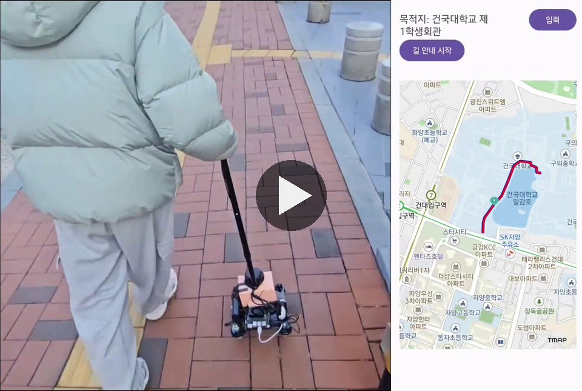
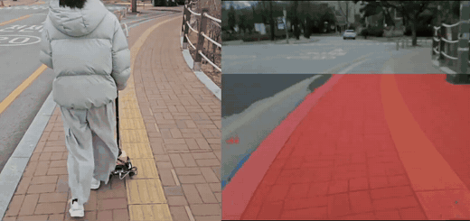
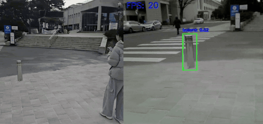
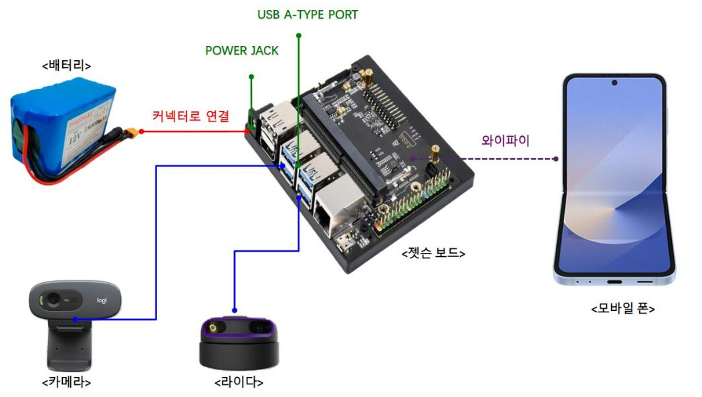
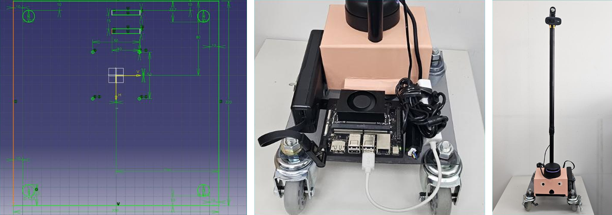
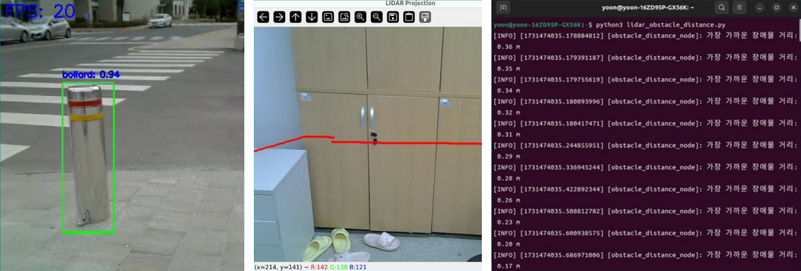
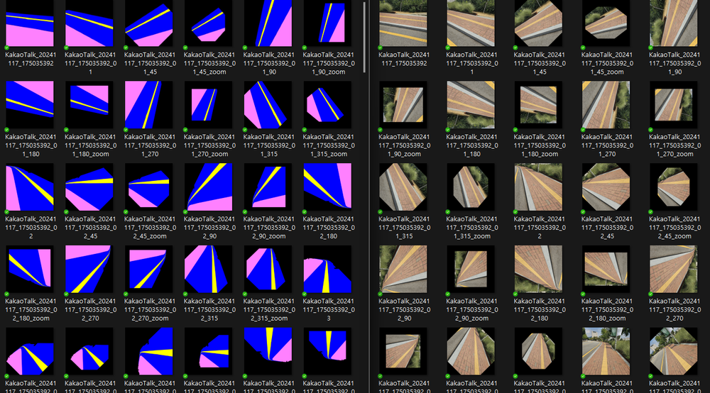

# 시각장애인 길안내 보행보조 시스템

**2024-2 드림학기제 프로젝트** (2024.09.01 ~ 2024.12.20)

시각장애인이 교내에서 안전하게 이동하도록 돕는 길안내 로봇입니다. 사용자가 스마트폰에 **음성으로 목적지를 말하면** 경로를 안내하고,
이동 중에는 Jetson에 연결된 카메라와 2D LiDAR로 주변을 인식해 **인도 이탈과 앞쪽 장애물의 거리·방향을 스마트폰 음성으로 알려줍니다.**
교내 정문 → 학생회관 경로를 시나리오로 시연했습니다.

<p align="center">
  <a href="https://youtu.be/G4C9G_xZx8s"></a><br>
  <sub>▶ 클릭하면 시연 영상(YouTube)으로 이동 – 음성 목적지 입력 → 길안내 → 인도 인식 → 장애물 탐지 → 도착</sub>
</p>

## 핵심 기능

| 질문 | 방법 |
| --- | --- |
| **인도에서 벗어나고 있는가** | U-Net 노면 세그멘테이션으로 인도/차도를 구분하고, 발 앞쪽 영역의 인도 비율로 이탈 여부와 방향(왼쪽·오른쪽) 판단 |
| **앞에 무엇이 있는가** | YOLOv5로 보행 경로 위 장애물(볼라드) 실시간 탐지 |
| **얼마나, 어느 쪽에 있는가** | LiDAR 점을 카메라 영상에 투영해 탐지된 장애물의 **거리(m)와 방향(왼쪽/정면/오른쪽)** 계산 |
| **어떻게 알려주는가** | WebSocket으로 결과를 스마트폰 앱에 보내 음성 안내(TTS). 길안내는 T Map API, 목적지 입력은 음성 인식(STT) |

## 결과

<table>
  <tr>
    <td align="center"><br><sub>주행 중 인도 세그멘테이션 – 빨간색이 인도로 인식된 영역</sub></td>
    <td align="center"><br><sub>횡단보도 앞 볼라드 탐지 (YOLOv5)</sub></td>
  </tr>
</table>

<details>
<summary>세그멘테이션 테스트 영상 (전체 화면 / 발 앞쪽 ROI)</summary>

<p align="center">
  
  
</p>

빨간색이 보도블록으로 인식된 영역이고, 차도·점자블록·화단은 다른 영역으로 분리됩니다.
오른쪽은 화면 하단(발 앞쪽)만 추론하는 ROI 버전으로, 벤치와 나무 같은 장애물이 보도 영역에서 빠지는 것을 볼 수 있습니다.
</details>

**사용자 설문** (시연 후 만족도 조사): 종합 만족도 **4.0 / 5**, 길안내 음성 안내의 명확성 **4.5 / 5**, 보조 지팡이 크기·무게 **3.25 / 5**
→ 하드웨어 경량화가 다음 개선 과제로 확인됐습니다.

## 하드웨어

<p align="center">
  <br>
  <sub>배터리(45W) · Jetson Orin Nano · 웹캠 · 2D LiDAR, 스마트폰과는 Wi-Fi(WebSocket)로 통신</sub>
</p>

<p align="center">
  <br>
  <sub>CATIA 베이스 플레이트 설계 → 조립 → 완성본 (지팡이 상단에 카메라, 하단 본체에 LiDAR · Jetson · 배터리)</sub>
</p>

## 인지

### 카메라 – LiDAR 장애물 인지

<p align="center">
  <br>
  <sub>YOLOv5 볼라드 탐지 · LiDAR 점을 카메라 영상에 투영(빨간 선) · LiDAR 최근접 장애물 거리 출력</sub>
</p>

- 카메라 내부 파라미터: 체스보드(내부 코너 9×7, 1.76 cm)로 계산 (640×480: fx = 390.20, fy = 390.02, cx = 321.55, cy = 238.40)
- LiDAR → 카메라 외부 파라미터: 2D 영상 좌표 ↔ 3D LiDAR 좌표 대응점으로 `solvePnP` 계산
- 바운딩박스 안에 투영된 LiDAR 점(먼 쪽 35% 제외)으로 거리를 구하고, 각도로 방향 결정 (±15° 정면, 15~40° 왼쪽/오른쪽)

### 인도 세그멘테이션 데이터

<p align="center">
  <br>
  <sub>교내 보도를 직접 촬영해 CVAT으로 마스킹하고(왼쪽), 회전·확대/축소·밝기 조절로 증강(오른쪽)</sub>
</p>

- U-Net(입력 128×128)으로 노면 22개 클래스 예측 → 결과를 **10×10 격자로 축소**해 가볍게 발행
- `sidewalk_node`가 격자의 **하단 4행(발 앞쪽)** 을 좌/우로 나눠 인도 픽셀 비율(≥ 40%)로 `on`/`off`와 이탈 방향 판단

## 시스템 구성

```
 USB Camera ─▶ camera_node ──/camera/image_raw──┬──▶ yolo_node ──/yolov5/detections──┐
                                                │                                     ▼
 RPLiDAR ───▶ rplidar_ros ──/scan───────────────┼──────────────────────────────▶ fusion_node
                                                │                                     │ /fusion_results
                                                │                                     ▼
                                                │                               websocket1 ──▶ 스마트폰 (장애물 안내)
                                                │
                                                └──▶ unet_node ──/unet/predictions──▶ sidewalk_node
                                                                                      │ /sidewalk/boundary_status
                                                                                      ▼
                                                                                websocket2 ──▶ 스마트폰 (인도 이탈 안내)
```

<details>
<summary>토픽 상세</summary>

| 토픽 | 타입 | 내용 |
| --- | --- | --- |
| `/camera/image_raw` | `sensor_msgs/Image` | 카메라 영상 (10 Hz) |
| `/scan` | `sensor_msgs/LaserScan` | RPLiDAR 스캔 |
| `/yolov5/detections` | `std_msgs/String` (JSON) | `{"detections": [{"bbox": [x1,y1,x2,y2], "confidence": 0.9, "class_name": "bollard"}]}` |
| `/unet/predictions` | `std_msgs/String` (JSON) | 세그멘테이션 결과를 10×10으로 줄인 RGB 마스크 |
| `/sidewalk/boundary_status` | `std_msgs/String` (JSON) | `{"status": "on"/"off", "direction": "center"/"left"/"right"/"unknown"}` |
| `/fusion_results` | `std_msgs/String` | `Object: bollard, Distance: 1.23m, Direction: center` |
| `/websocket1`, `/websocket2` | `std_msgs/String` | 장애물 정보 / 인도 이탈 정보를 WebSocket 연동용으로 재발행 |
</details>

## 코드 구성

| 위치 | 내용 |
| --- | --- |
| `dream_final/` | **Jetson에서 실행한 최종 ROS 2 노드 7개** (`camera` · `yolo` · `unet` · `sidewalk` · `fusion` · `websocket1/2`) |
| `dream_final/dev/` | 개발 중 이전 버전·테스트 코드 (스레딩 전 YOLO 노드, 전체 마스크 U-Net 노드, LiDAR 단독 거리 테스트 등) |
| `calib/` | 체스보드 카메라 캘리브레이션 → `camera_matrix.npy`, `dist_coeffs.npy` |
| `unet/` | 노면 세그멘테이션 추론 실험 – **frame skip**(5프레임마다 추론)과 **ROI**(화면 하단만 추론)로 속도 개선 |
| `yolov5-master/` | Ultralytics YOLOv5 + 직접 추가한 `detectbollard.py`(웹캠 볼라드 탐지, FPS 표시) |
| `fusion/` | RPLiDAR–카메라 캘리브레이션 참고 코드(ROS 1)와 ROS 2로 옮기던 버전 |

<details>
<summary>노드별 상세 · 학습 모델</summary>

| 노드 | 설명 |
| --- | --- |
| `camera_node.py` | 카메라(0번)를 열어 10 Hz로 `/camera/image_raw` 발행 |
| `yolo_node.py` | YOLOv5 커스텀 모델(`best.pt`, 볼라드)로 탐지. 추론을 **별도 스레드 + 프레임 큐**로 분리해 속도 개선(스레딩 전 약 10 fps), confidence ≥ 0.8만 발행 |
| `unet_node.py` | U-Net(`unet129.h5`, 입력 128×128)으로 22개 노면 클래스 예측, 10×10 격자로 축소해 발행 |
| `sidewalk_node.py` | 10×10 마스크 하단 4행을 좌/우로 나눠 인도 비율(≥ 40%) 계산 → `on`/`off`, `left`/`right` |
| `fusion_node.py` | LiDAR 점을 영상에 투영해 바운딩박스 안 점으로 장애물 거리·각도 계산 |
| `websocket1.py`, `websocket2.py` | 장애물 / 인도 이탈 결과를 WebSocket 연동용으로 재발행 |

노면 클래스(22개): 배경, 보도(블록·시멘트·우레탄·아스팔트·흙/돌·파손·기타), 점자블록(정상·파손), 차도(일반·횡단보도),
이면도로(일반·횡단보도·과속방지턱·파손), 자전거도로, 주의구역(계단·맨홀·가로수·그레이팅·공사구역)

| 파일 | 모델 | 클래스 |
| --- | --- | --- |
| `unet129.h5` (최종), `unet128.h5`, `925PM.h5`, `best33.h5` | U-Net | 노면 22 class |
| `pspunet_weight.h5`, `pspnet_mode6l.h5` | PSPNet 계열 | 노면 |
| `best.pt` (최종) = `bollard_best.pt` | YOLOv5 | bollard |
| `best_person.pt` / `best_car.pt` / `best_3.pt` | YOLOv5 | Person / cars, truck / Bus, Human, MotorBike, Sedan, Truck 등 |

> 가중치 파일(`*.h5`, `*.pt`)은 용량 문제로 저장소에 포함되어 있지 않습니다.
> 코드 안의 경로는 작업했던 PC(`/home/rth/...`)와 Jetson(`/home/d/d_ws/src/dr/...`) 기준입니다.
</details>

## 개발 환경

| 구분 | 내용 |
| --- | --- |
| 보드 | NVIDIA Jetson Orin Nano (JetPack 6.1, CUDA 12.6, cuDNN 9.3.0) |
| OS / 미들웨어 | Ubuntu 22.04 LTS, ROS 2 Humble |
| 딥러닝 | PyTorch 2.5.0 (Jetson용) – YOLOv5s, TensorFlow – U-Net |
| 센서 | Logitech C270 웹캠, RPLiDAR (2D) |
| 앱 연동 | rosbridge WebSocket → Android 앱 (T Map API 길안내, 음성 인식 · 음성 안내) |
| 기구 설계 | CATIA |

## 한계 및 개선 방향

- 지팡이 크기·무게 만족도가 3.25 / 5로 가장 낮음 → 하드웨어 경량화
- 탐지 장애물이 볼라드 1종 → 공유 킥보드 등 장애물 클래스 확대
- 교내 보도 위주 데이터 → 횡단보도 등 다양한 환경 데이터로 확장

## Credits

- [ultralytics/yolov5](https://github.com/ultralytics/yolov5) (AGPL-3.0)
- rplidar_camera_calibration 참고 코드, `camera.launch.py` (© Tinker Twins, BSD)
